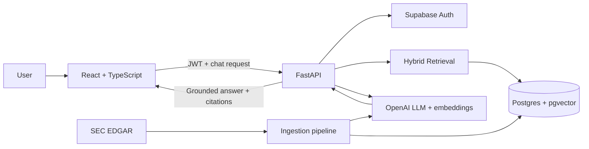

# InsightVault

**InsightVault** is a full-stack, citation-grounded AI research assistant for querying SEC filings in natural language. It combines a React/TypeScript frontend with a FastAPI backend, Supabase Postgres, `pgvector`, full-text search, and OpenAI models to retrieve relevant filing passages and return answers with verifiable source citations.

The current implementation is optimized for SEC 10-K/10-Q research. Its architecture is intentionally modular so the ingestion and retrieval layers can be extended to additional document collections later.

## What it does

- Authenticated browser-based research workspace
- Natural-language questions over a curated SEC filing corpus
- Hybrid retrieval using vector similarity + Postgres full-text search
- Reciprocal Rank Fusion (RRF) for result merging
- Citation-grounded LLM responses with source excerpts
- Conversation history and persistent chat state
- SEC EDGAR sample-data downloader and ingestion pipeline
- Alembic-managed Postgres schema and `pgvector` support
- Docker/Railway deployment configuration

## Architecture



### Query flow

`Question → FastAPI → vector + keyword retrieval → ranked filing chunks → LLM → grounded answer + citations`

## Tech stack

| Layer | Technology |
| --- | --- |
| Frontend | React, TypeScript, Vite, Tailwind CSS, shadcn/ui |
| Backend | Python 3.12+, FastAPI, Pydantic |
| Database | Supabase Postgres |
| Retrieval | `pgvector`, Postgres full-text search, RRF |
| Auth | Supabase Auth |
| ORM / migrations | SQLAlchemy, Alembic |
| LLM / embeddings | OpenAI |
| Deployment | Docker, Railway |
| Package managers | `uv`, `pnpm` |

## Repository layout

```text
InsightVault/
├── backend/           # FastAPI API, retrieval, grounding, DB, migrations, tests
├── frontend/          # React + TypeScript SPA
├── data/              # SEC sample-data tooling
├── docs/              # architecture and setup guides
├── AGENTS.md          # contributor/agent guidance
└── README.md
```

## Prerequisites

- Python 3.12+
- `uv`
- Node.js 20+
- `pnpm`
- Supabase project
- OpenAI API key

## Environment setup

### Backend

```bash
cd backend
cp .env.example .env
```

Configure:

- `SUPABASE_URL`
- `SUPABASE_ANON_KEY`
- `SUPABASE_SERVICE_ROLE_KEY`
- `DATABASE_URL`
- `OPENAI_API_KEY`
- `ALLOWED_ORIGINS=http://localhost:5173`

### Frontend

```bash
cd frontend
cp .env.example .env
```

Configure:

- `VITE_API_BASE_URL=http://localhost:8000`
- `VITE_SUPABASE_URL`
- `VITE_SUPABASE_ANON_KEY`

Real secrets belong only in local `.env` files. The repository keeps placeholder `.env.example` files and ignores `.env` files.

## Install and run

### 1. Database and backend

```bash
cd backend
uv sync
uv run alembic upgrade head
uv run uvicorn app.main:app --reload
```

Backend API: `http://127.0.0.1:8000`  
FastAPI docs: `http://127.0.0.1:8000/docs`

### 2. Frontend

In a second terminal:

```bash
cd frontend
pnpm install
pnpm dev
```

Open the Vite development URL, normally `http://localhost:5173`.

## Build the sample SEC corpus

Download recent 10-K filings for the configured sample companies:

```bash
uv run data/download.py
uv run data/convert_to_markdown.py
```

Load filing metadata and generate chunks/embeddings:

```bash
cd backend
uv sync --extra ingest
uv run python -m ingest.load_source_documents
uv run python -m ingest.chunk_and_embed --all
```

The default sample corpus includes Apple, Microsoft, NVIDIA, Amazon, and Alphabet filings. Downloaded corpus files are intentionally excluded from Git.

## Quality checks

```bash
cd backend
uv run pytest -m "not integration"
uv run ruff check .

cd ../frontend
pnpm lint
pnpm build
```

Integration tests require valid Supabase/OpenAI credentials.

## Key engineering decisions

**Why FastAPI?** Python is a practical fit for document ingestion, embeddings, retrieval, evaluation, and LLM orchestration while FastAPI provides typed asynchronous APIs.

**Why Postgres + pgvector?** Application state, metadata, lexical search, and vector retrieval can live in one database instead of introducing a separate vector database for this scale.

**Why hybrid retrieval?** Semantic similarity is useful for concept matching while full-text search preserves exact financial terminology and identifiers. RRF combines both rankings without requiring scores to share the same scale.

**Why citation grounding?** The assistant is designed to answer only from retrieved passages. Every factual claim is tied to a citation and underlying excerpt; unsupported questions return an insufficient-evidence response instead of a fabricated answer.

## Security notes

- `.env` and `.env.*` are gitignored except `.env.example`
- Supabase service-role credentials stay backend-only
- Browser code uses only public Supabase configuration
- User requests are authenticated with Supabase bearer tokens
- Database changes are managed through Alembic migrations

## Current scope

InsightVault currently targets SEC filings and should not be described as a general arbitrary-PDF upload platform without additional ingestion work. The architecture can be extended to other document sources by adding new parsing/metadata adapters to the ingestion layer.

## Future improvements

- Add a generic PDF/document upload ingestion adapter
- Add document comparison workflows
- Add retrieval-quality evaluation datasets and dashboards
- Add organization-level RBAC
- Add additional model/provider support behind a common interface

## Reference implementation

This project is an adapted implementation based on the public **Document Copilot** tutorial/reference repository by Dave Ebbelaar: `daveebbelaar/document-copilot`. The application has been rebranded as InsightVault and its documentation has been reorganized for this implementation. Existing upstream notices and attribution should be preserved where applicable.
